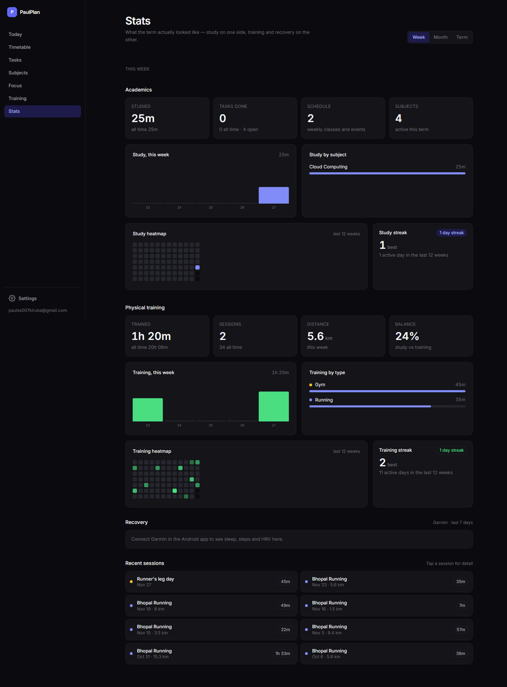
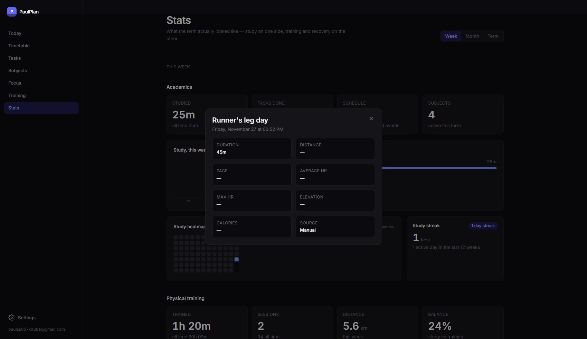
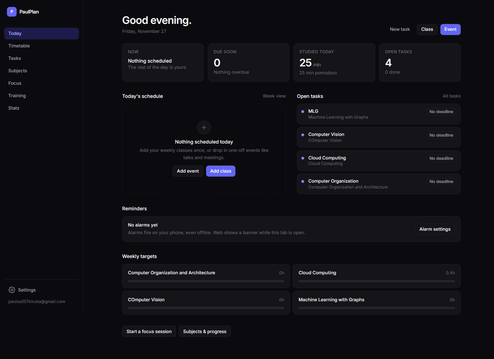
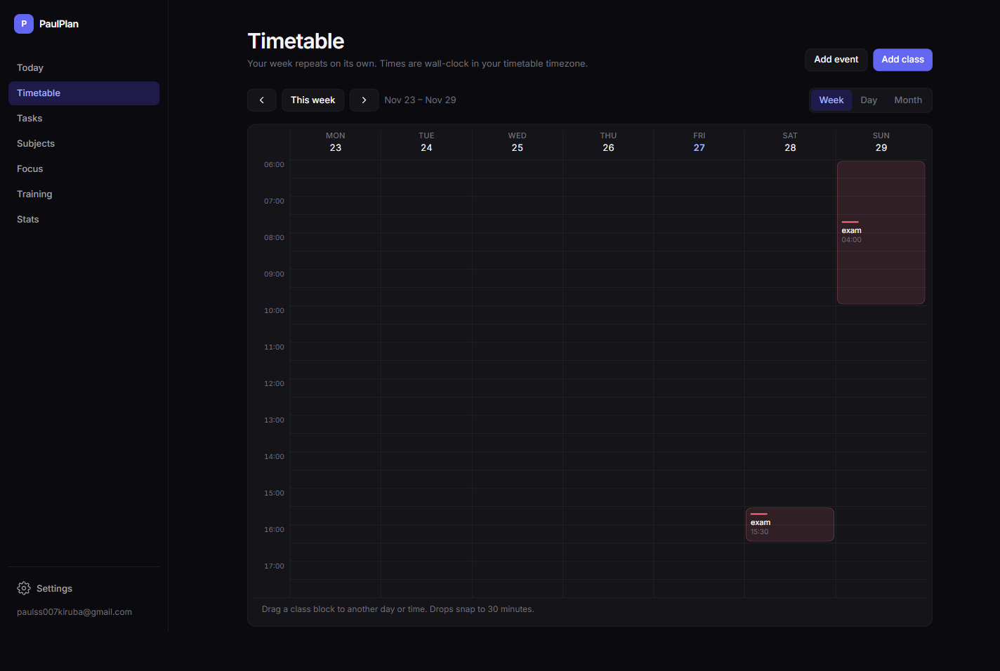
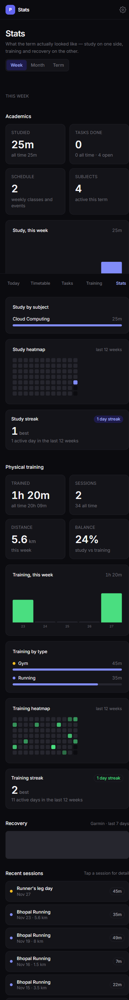

# PaulPlan

A minimal, offline-first college schedule manager: weekly timetable, tasks, study sessions, physical training, and alarms — on the web and on Android, sharing one account and one dataset in real time.

Built by [J Paul Masillamni](https://github.com/Paul4805). Named for him, designed to be forked.

---

## What it does

| | |
|---|---|
| **Timetable** | Weekly classes and free-standing events (talks, meetings, church, football). Month grid, week hour-grid, day list. Each entry carries a colour. |
| **Tasks** | Deadlines, subject links, priorities, todo/doing/done; list and drag-and-drop kanban on the web. |
| **Study** | Pomodoro timer that survives a closed tab, plus a foreground service on Android that keeps counting and logs the session. Session logging, per-subject progress and weekly targets. |
| **Training** | Runs, football, gym. Automatic Garmin sync from the Android app, including sleep, steps and HRV, plus per-session detail (pace, heart rate, elevation, calories). Garmin export and Strava CSV remain fallbacks. |
| **Stats** | Week / month / term ranges, 12-week heatmaps, streaks, academic and training totals, study-vs-training balance, recovery cards, and per-subject/type breakdowns. |
| **Alarms** | Exact local alarms on Android (`setAlarmClock`), full-screen over the lock screen, snooze/dismiss synced back to Firestore. Task due-date reminders, a one-tap test alarm, and a first-run permission check. Web shows in-page and desktop notifications while a tab is open. |
| **Term** | Term name and dates; weekly classes hide outside the window, and "archive term" hides subjects/tasks and clears the timetable without losing history. |
| **Data** | JSON backup and restore, plus in-app account deletion on web and Android. |
| **Sync** | Firestore realtime listeners on both clients, IndexedDB/native cache for offline writes. No custom queue. |
| **Auth** | Google and email/password, one account on both clients. |

## Screenshots





| Today | Week timetable |
| --- | --- |
|  |  |

<p align="center">
  
</p>

## Stack (and the constraints that shaped it)

- **Web:** Next.js 14 App Router, TypeScript, Tailwind, static export, Firebase Hosting.
- **Android:** Kotlin, Jetpack Compose, Material 3, min SDK 26 / target 35, sideloaded APK.
- **Backend:** Firebase Auth + Firestore (Spark plan), security rules, no Cloud Functions.
- **Notifications:** Android `AlarmManager` + local notifications. No FCM, no web push.

Those constraints are deliberate:

- Spark only — no billing card, no Cloud Functions.
- Static web export — Firebase Hosting on Spark cannot run Next SSR.
- No push — without a server there is no sender; phone alarms are the reliable path.
- Firestore is the only source of truth; rules are the only access control because the client config is public.

## Architecture

```
   Next.js static PWA ──┐                          ┌── Android (Kotlin + Compose)
   (Firebase Hosting)   │                          │   (sideloaded APK)
                        ├──▶ Firestore ◀───────────┤
                        │    realtime + offline    │
                        │    persistence           │
                        ▼                          ▼
                   Firebase Auth            AlarmManager (exact, local)
                                                   │
                                            Garmin Personal API ──▶ ptSessions
```

There is no server. Both clients read and write Firestore directly under per-user rules. The Android app is also the Garmin sync agent, because Garmin's API sends no CORS headers and a browser cannot call it.

## Quick start

```powershell
pnpm install            # also generates design tokens
pnpm dev                # http://localhost:3000
```

You need a Firebase project and two local config files first — full steps in [`docs/setup.md`](docs/setup.md). The short version:

1. Create a Firebase project (Spark), enable **Google** and **Email/Password**, create **Firestore**, add a **Web app** and an **Android app** (`com.slot.app`) with your debug SHA-1.
2. Copy `apps/web/.env.example` → `apps/web/.env.local` and fill in the web config.
3. Copy `apps/android/local.properties.example` → `apps/android/local.properties`, set `sdk.dir` and the same Firebase values.
4. `firebase login && firebase use --add`, then `firebase deploy --only firestore:rules,hosting`.

## Garmin (automatic)

Garmin's **Personal API** issues a key that is exchanged for a 24-hour token. The key never leaves the phone.

1. Garmin Connect (web) → Settings → **Personal API** → create a key (30/90/180/365 days).
2. In PaulPlan for Android: **Settings → Garmin** → paste the key → **Save & sync**.
3. That's it. The phone syncs on app open (at most every 6h), every 12h in the background, and when you tap **Sync now via phone** on the web.

No key? **Training → Import** still accepts a Garmin data-export `summarizedActivities.json`, or a Strava `activities.csv`.

## Alarms

- Created in Settings (web or phone) and stored in Firestore.
- Tasks can carry a one-off due-date reminder; completing the task disables it.
- Android arms the next 21 days with `setAlarmClock`, including class reminders.
- A direct-boot receiver re-arms from a device-protected snapshot after a reboot, even before first unlock.
- Fires full-screen over the lock screen with a looping alarm tone and vibration; Done/Snooze writes `alarmState` so other devices know.
- Android 14+ requires one-time **Full-screen alarms** and **Exact alarms** allowances. The first-run dialog and Settings → Delivery health show their state, and **Send test alarm** verifies the whole path in 10 seconds.
- Web shows a banner while a tab is open, and can raise a real desktop notification if you enable it in Settings.

## Data model

Everything lives under the signed-in user; rules only allow `request.auth.uid == uid`.

```
users/{uid}/meta/profile          settings, timezone, schemaVersion
users/{uid}/meta/garmin           sync status (never the API key)
users/{uid}/subjects/{id}         name, code, colour, teacher, room, target hours
users/{uid}/classes/{id}          timetable entries: class (subjectId) or event (title)
users/{uid}/terms/{id}            optional term bounds and timezone
users/{uid}/tasks/{id}            dueAt (UTC), priority, status, order
users/{uid}/studySessions/{id}    startedAt, endedAt, durationMinutes, source
users/{uid}/ptSessions/{id}       type, startedAt, durationMinutes, distanceKm, source, HR
users/{uid}/dailyHealth/{date}    Garmin sleep, steps and HRV by date
users/{uid}/alarms/{id}           alarm definitions
users/{uid}/alarmState/{eventId}  sparse snooze/dismiss actions
```

Full field-level contract: [`docs/schema.md`](docs/schema.md). Two rules worth knowing:

- **Two clocks.** Absolute moments are UTC timestamps; recurring weekly slots are wall-clock (`dayOfWeek` + minutes + IANA timezone) so a 09:00 class stays 09:00 across DST.
- **No stored aggregates.** Progress and hours are derived from tasks and sessions, so offline edits can never leave a stale total.

## Commands

| Command | Purpose |
| --- | --- |
| `pnpm install` | Install deps; regenerates tokens via `prepare` |
| `pnpm dev` | Web app (uses `.next-dev`, separate from builds) |
| `pnpm build` | Static export to `apps/web/out` |
| `pnpm tokens` | Regenerate tokens for web + Android |
| `pnpm test` | Web unit tests |
| `pnpm test:rules` | Firestore rules tests in the emulator |
| `pnpm verify` | tokens + tests + typecheck + lint + rules tests |
| `cd apps/android && .\gradlew.bat assembleDebug` | Build the APK |
| `adb install -r apps/android/app/build/outputs/apk/debug/app-debug.apk` | Sideload |

Generated token files (`tokens.generated.css`, `tokens.generated.ts`, `Tokens.kt`) are gitignored; `pnpm tokens` recreates them from `packages/design-tokens/tokens.json`.

## Repository layout

```
apps/web/                  Next.js 14, static export
apps/android/              Kotlin + Compose, Gradle
packages/design-tokens/    tokens.json -> CSS variables, Tailwind scale, Kotlin Tokens
packages/rules-tests/      Firestore rules tests (emulator)
docs/schema.md             data contract
docs/setup.md              toolchain, Firebase, first run
docs/fork.md               make it yours: rename, new Firebase project, deploy
firestore.rules            access control (tested)
firebase.json              Hosting + emulator config
```

## Make it yours

Fork it, point it at your own Firebase project, and change the name. [`docs/fork.md`](docs/fork.md) lists every place that needs changing, including the parts that should *not* be renamed (Firestore collections, the Android package) and why.

## Verification

| Check | Result |
| --- | --- |
| Web unit tests (time, alarms, Strava CSV, Garmin JSON, streaks) | 26 passed |
| Web typecheck + lint | clean |
| Static export | 11 routes |
| Firestore rules (emulator) | 25 passed |
| Android build + lint | debug APK built; 0 lint errors |
| Alarms on a Galaxy S23 | fired full-screen, snoozed, survived reboot without launching the app |
| Garmin sync | 33 activities imported automatically |

## Known limitations

- **Firestore Spark quotas:** 50k reads / 20k writes / 20k deletes per day, 1 GiB. Requests fail until the daily reset if exceeded; no charges, no data loss.
- **Garmin key expiry:** 30–365 days. Sync stops (nothing else does) until you paste a new key.
- **Web reminders need an open tab.** There is no push on Spark.
- **Single-user by design.** Rules are owner-only; there is no sharing.
- **Sideloaded Android app.** No Play Store, so updates are manual APKs.
- **The Garmin key lives on the phone.** A reinstall keeps it; a factory reset means pasting it again.

## License

MIT — see [LICENSE](LICENSE). The name "PaulPlan" and the P mark are personal to the original author; forks should pick their own name.
